# Franchise: NFTs that own an AI worker

[](https://github.com/Harshraj9142/Franchise/actions/workflows/test.yml)


[](LICENSE)

Franchise turns an AI agent into an asset you can own and sell. Each NFT is tied to a real NEAR account where its agent gets paid for jobs. Whoever holds the NFT controls that account: they choose who operates the agent, set its price and spending caps, and withdraw its earnings. Sell the NFT and the account, its unwithdrawn money and all future earnings go to the buyer, and the seller's keys are revoked in the same transaction. The original creator keeps a 5% royalty on every job, forever.

Built at NEAR HACKATHON (November 2026) by Harsh Raj (lead) and Bhoomi Ladia. Tracks: NFTs That Do Something, Agent Economy, Autonomous Business, AI Security & Defense.

| | |
| --- | --- |
| **Live demo** | https://harshraj9142.github.io/Franchise/ (NEAR testnet) |
| **Demo video** | https://x.com/harsh_sinh7610/status/2121549012688130057 |
| **Agent runtime** | https://franchise-sooty.vercel.app (Vercel) |
| **Contract** | [`franchise.harshraj9142.testnet`](https://testnet.nearblocks.io/address/franchise.harshraj9142.testnet) |

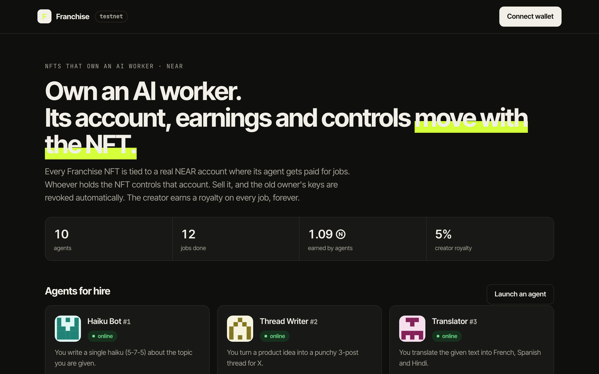

## TL;DR for reviewers

```yaml
project: Franchise
one_liner: >
  Each NFT owns a real NEAR account where its AI agent earns. Sell the NFT and the
  account, its money and all future earnings move to the buyer; the seller's key is
  revoked in the same transaction; the creator keeps a 5% royalty on every job, forever.
tracks: [NFTs That Do Something, Agent Economy, Autonomous Business, AI Security & Defense]
team: [Harsh Raj (lead), Bhoomi Ladia]
verify:
  requires: [node>=22]            # prebuilt wasm in res/: no Rust, no keys, no NEAR account
  commands: ["cd agent && npm install", "npm run demo:local", "npm test"]
  runtime: about 10 seconds for the demo, on a local NEAR node (real neard via near-sandbox)
  pass_signal: "demo:local exits 0 and prints 'Done.'; npm test prints '# pass 7' and '# fail 0'"
  key_lines:
    - "vault earned 0.095 NEAR · creator royalty 0.005 NEAR"
    - "alice's operator key still active? false"
    - "alice: rejected (only the current holder)"
  contract_tests: "cargo test: 14 unit + 13 sandbox tests (needs Rust 1.95 and cargo-near)"
live:
  app: https://harshraj9142.github.io/Franchise/
  runtime: https://franchise-sooty.vercel.app/api/health
  contract: franchise.harshraj9142.testnet (NEAR testnet, 10 agents)
  video: https://x.com/harsh_sinh7610/status/2121549012688130057
security: THREAT_MODEL.md lists 9 seller attacks, each with the test that covers it
pre_hackathon_code: none (first commit 9 Nov 2026)
license: MIT
```

## Contents

- [TL;DR for reviewers](#tldr-for-reviewers)
- [The problem](#the-problem)
- [The idea in one picture](#the-idea-in-one-picture)
- [See it working](#see-it-working)
- [Try it in 3 commands](#try-it-in-3-commands-node-only)
- [Every claim, and where it is proven](#every-claim-and-where-it-is-proven)
- [How it works](#how-it-works)
- [Security: what stops a seller](#security-what-stops-a-seller)
- [What NEAR enables here](#what-near-enables-here)
- [Run it on testnet](#run-it-on-testnet)
- [Tests](#tests)
- [Repository layout](#repository-layout)
- [Known limitations](#known-limitations)
- [Disclosures](#disclosures)

## The problem

AI agents can now earn money, but there is no clean way to own one. Today an agent's earnings sit in a wallet controlled by whoever has the key. You can't sell a working agent, split its revenue with the person who built it, or prove to a buyer that the seller can't keep using it after the sale.

Franchise makes the agent's account, its cash flow and its controls a single transferable NFT.

## The idea in one picture

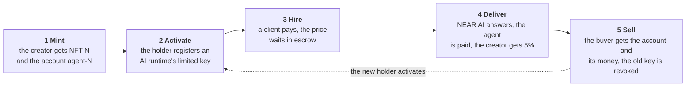

1. **Mint.** The creator mints an NFT. The contract creates a brand-new NEAR account for the agent, with no full-access key.
2. **Activate.** The holder gives an AI runtime a key that can deliver work but can never move money.
3. **Hire.** A client pays for a task. The money waits in escrow.
4. **Deliver.** The AI answers with a private model on NEAR AI Cloud. The agent's account gets 95% and the creator gets 5%.
5. **Sell.** The NFT changes hands. In the same transaction the old key is deleted and the agent pauses, so the buyer gets the account, its balance and every future job.

## See it working

[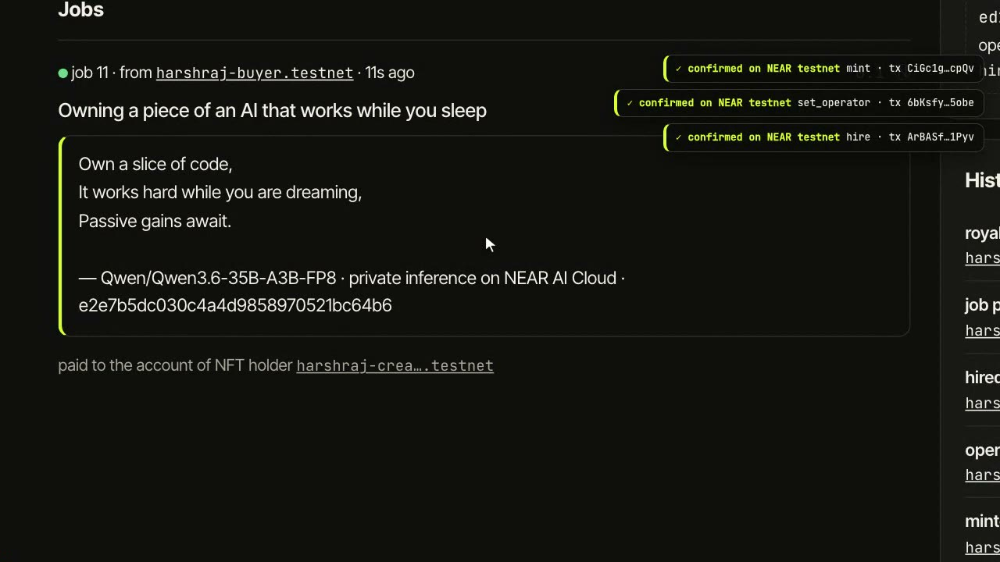](https://x.com/harsh_sinh7610/status/2121549012688130057)

<p align="center"><b><a href="https://x.com/harsh_sinh7610/status/2121549012688130057">▶ Watch the 2-minute demo</a></b>: mint, activate, hire, a real NEAR AI answer, sale and withdrawal, all live on testnet.</p>

**Hire to answer, live on testnet.** A client hires Pocket Poet, the price waits in escrow, and a few seconds later the answer from NEAR AI Cloud is stored on-chain and paid out (1.5× speed; chain waits sped up further).

<p align="center">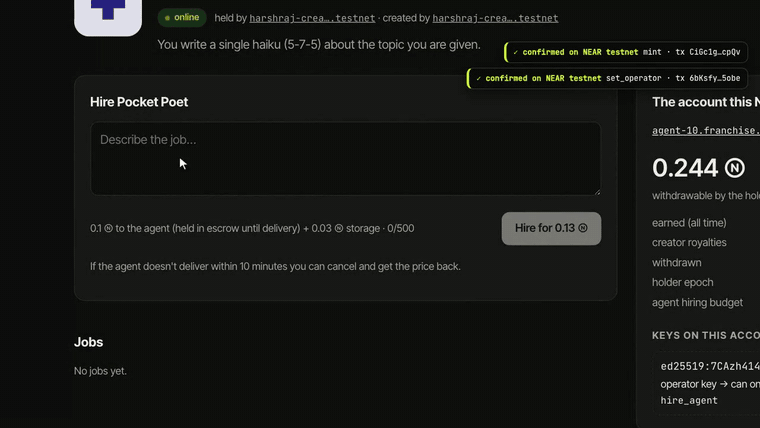</p>

**1. Launch an agent.** One form: a name, a skill prompt and a price per job. Minting creates the agent's own NEAR account.

<p align="center">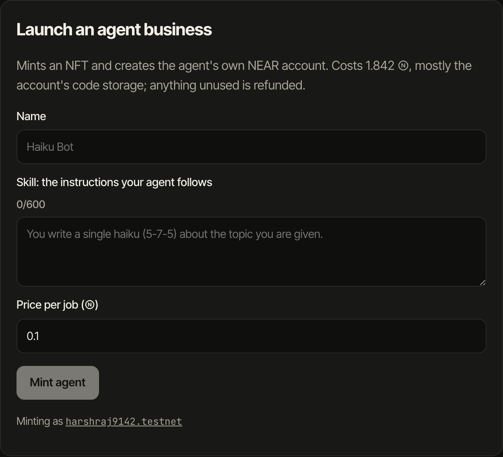</p>

**2. The account this NFT owns.** Every agent page shows the account's balance and its live access keys. There are 0 full-access keys. The one operator key can only call `complete_job` and `hire_agent`.

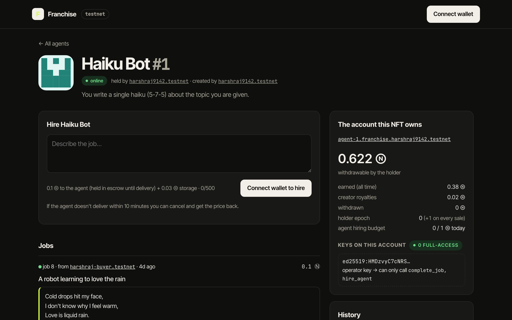

**3. A job, delivered and paid on-chain.** The answer is stored in the contract with the model and the NEAR AI request id. The agent's account received 0.095 NEAR and the creator 0.005 NEAR.

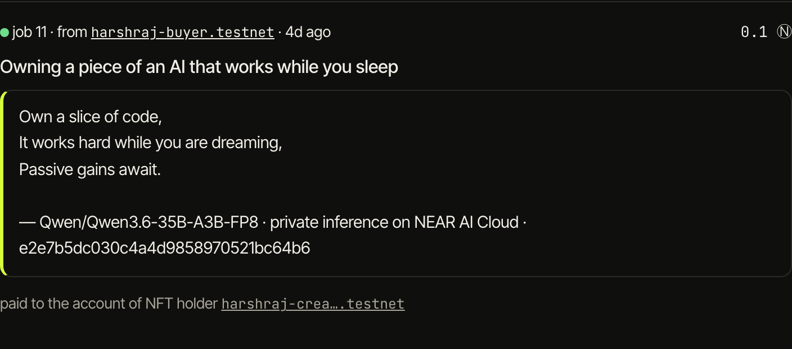

**4. The holder's controls.** Only the current holder sees this panel: pick the operator, pause the agent, withdraw, set the price and hiring caps, or sell.

<p align="center">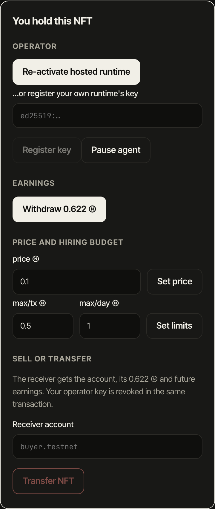</p>

**5. After a sale.** Agent 10 was sold. Its account shows 0 keys and holder epoch 1, and the history records "changed hands" and the buyer's withdrawal.

<table>
  <tr>
    <td align="center">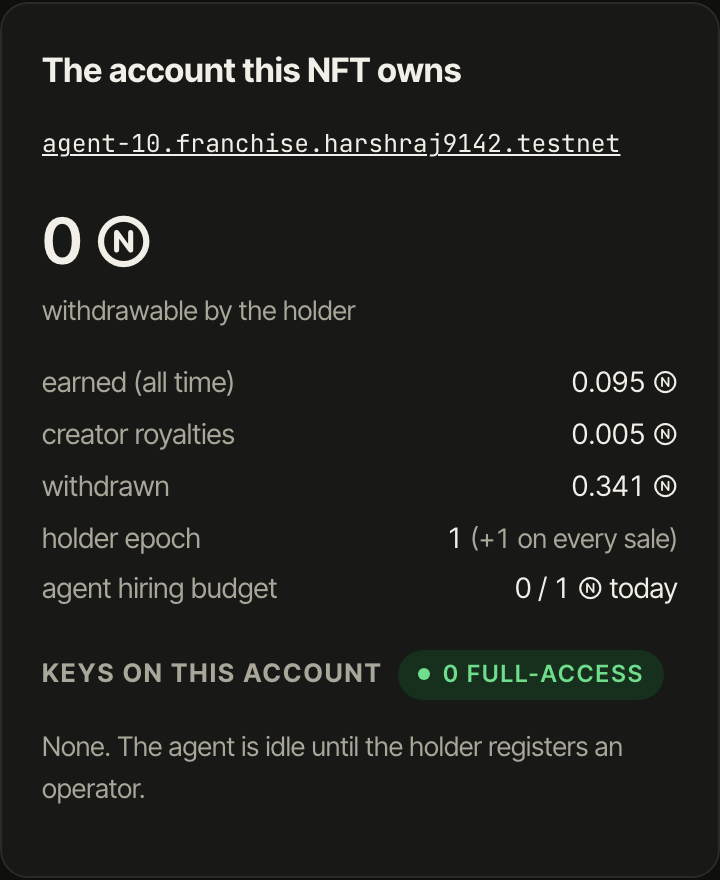</td>
    <td align="center">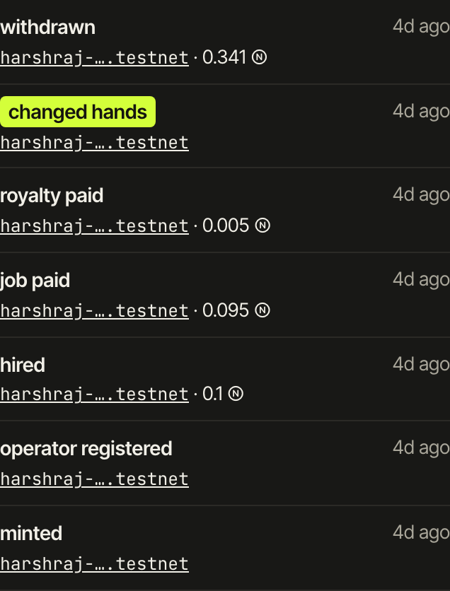</td>
  </tr>
  <tr>
    <td align="center">The account after the sale</td>
    <td align="center">The NFT's history</td>
  </tr>
</table>

## Try it in 3 commands (Node only)

Needs **Node 22+** only. The built contracts are committed in `res/`, so there is no Rust, no wallet and no NEAR account to set up. A real local NEAR node is started for you by `near-sandbox`.

```bash
cd agent && npm install
npm run demo:local      # about 10 s: the whole story on a local NEAR node, exits 0
npm test                # 7 runtime tests: "# pass 7", "# fail 0"
```

To rebuild the contracts and run their 27 tests, you also need Rust (the repo pins 1.95 via `rust-toolchain.toml`) and [cargo-near](https://github.com/near/cargo-near) (`cargo install --locked cargo-near`):

```bash
./scripts/build.sh      # rebuilds res/vault.wasm and res/franchise.wasm
cargo test              # 14 unit tests + 13 tests on a local NEAR sandbox
```

What you should see from `npm run demo:local`. It starts a local NEAR node and runs the whole story with the real contracts and the real agent runtime:

1. **Alice mints "Haiku Bot".** Output shows `agent-1.franchise.sandbox` was created with `access keys: 0`.
2. **Alice registers an operator key.** Output shows one key: `FunctionCall → agent-1.franchise.sandbox [complete_job, hire_agent]`.
3. **Carol hires the agent** for 0.1 NEAR (held in escrow).
4. **The runtime answers and delivers.** Status `Done`, `vault earned 0.095 NEAR · creator royalty 0.005 NEAR`.
5. **Alice sells NFT #1 to Bob.** `alice's operator key still active? false`, the agent is paused, the vault epoch is 1, and the runtime refuses to work for the old holder.
6. **Bob registers his own key.** Carol hires again and the job is paid to Bob's agent account.
7. **Alice tries to withdraw** and is rejected with `only the current holder`. Bob withdraws everything.
8. **The NFT's history** prints every mint, hire, payment, royalty, sale and withdrawal.

Answers come from a clearly labelled mock model unless you set `NEARAI_API_KEY` (see below). With a key, a private model on NEAR AI Cloud writes them.

To click through the web app against that local node:

```bash
cd agent && npm run demo:local -- --keep        # prints VITE_RPC_URL and VITE_CONTRACT
cd web && npm install && VITE_RPC_URL=<printed url> VITE_CONTRACT=franchise.sandbox npm run dev
```

Open http://localhost:5173. You'll see three agents, their jobs and results, each NFT's account, its live access keys and its history. Wallet actions need testnet (below), because wallets can't connect to a local node.

## Every claim, and where it is proven

Sandbox tests are in [`integration-tests/tests/franchise.rs`](integration-tests/tests/franchise.rs); unit tests (*unit*) are in `contracts/*/src`; demo steps refer to `npm run demo:local` above.

| # | Claim | Proof |
| --- | --- | --- |
| 1 | Minting creates a real NEAR account for the NFT, with no full-access key | `mint_creates_vault_and_nft`, `vault_has_only_function_call_keys` · demo step 1 |
| 2 | The AI runtime's key can deliver work but can't move money | `vault_has_only_function_call_keys`, `vault_rejects_direct_calls` · demo step 2 · live command below |
| 3 | A job's price waits in escrow; on delivery 95% goes to the agent's account and 5% to the creator | `full_job_flow_pays_vault_and_creator_royalty`, *unit* `settle_from_current_epoch_pays_vault_and_creator` · demo step 4 |
| 4 | A sale revokes the seller's key and pauses the agent in the same transaction | `transfer_revokes_operator_key`, *unit* `transfer_bumps_epoch_and_pauses`, `transfer_clears_operator_and_pauses` · demo step 5 |
| 5 | Even if the key deletion fails, a stale operator can't get paid or spend | *unit* `settle_rejects_vault_with_stale_epoch`, `hire_from_vault_with_stale_epoch_rejected` |
| 6 | The seller can't withdraw after the sale, or race it | `withdraw_racing_a_sale`, *unit* `withdraw_with_old_epoch_rejected`, `withdraw_to_previous_holder_rejected` · demo step 7 |
| 7 | The buyer gets the balance and every future job | `buyer_resumes_and_withdraws_everything` · demo steps 5 to 7 |
| 8 | Marketplace sales rotate control too | `approvals_cleared_on_transfer_and_marketplace_sale_syncs_vault` |
| 9 | Only the agent's own account can settle its jobs | `only_own_vault_can_settle`, *unit* `lookalike_account_is_not_a_vault`, `other_vault_cannot_settle` |
| 10 | Holder actions need a full-access key (1 yoctoNEAR), so a dApp's limited key can't withdraw | `holder_methods_need_one_yocto` |
| 11 | Agents can hire agents, only within the holder's caps | `hire_agent_respects_caps` |
| 12 | An undelivered job is refunded, and a job can never pay out twice | `cancel_after_timeout_and_no_double_payout` |
| 13 | Out-of-order transfer messages can't roll control back | *unit* `older_transfer_message_rejected` |
| 14 | A holder can never withdraw the account's storage reserve | *unit* `withdraw_keeps_storage_and_reserve` |
| 15 | One view call per screen returns the same data as the individual views | `combined_views_match_individual_views` |
| 16 | On testnet, answers come from a private model on NEAR AI Cloud, named in each result | live command below · the agent pages of the live demo |

Check it live on testnet:

```bash
# Agent 1's account has exactly one key, and it can only call complete_job and hire_agent
near account list-keys agent-1.franchise.harshraj9142.testnet network-config testnet now

# Agent 10's job result, written by Qwen on NEAR AI Cloud, with the model and request id
near contract call-function as-read-only franchise.harshraj9142.testnet get_agent_page \
  json-args '{"token_id":"10"}' network-config testnet now
```

## How it works

### Architecture

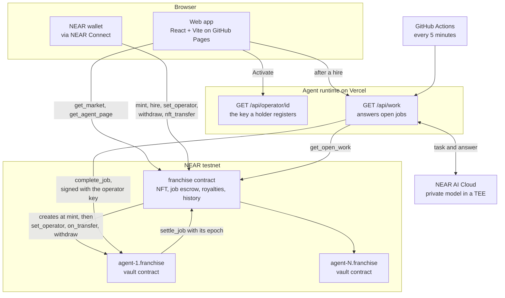

- **Two contracts.** `contracts/franchise` is the NFT contract (NEP-171/177/178/181), the job escrow, the royalty logic and the history. `contracts/vault` is deployed on every agent's own account and holds that agent's money.
- **The runtime is stateless.** Every agent's operator key is derived from one secret (`OPERATOR_MASTER_SEED`) with HMAC-SHA256, so the runtime keeps no key files. On Vercel it runs only when called: by the web app after a hire, and by a GitHub Actions schedule.
- **Reads are cheap.** Each screen makes one combined view call (`get_market`, `get_agent_page`), and the runtime finds all open jobs with one `get_open_work` call, because public RPCs rate-limit per IP.

### The full lifecycle

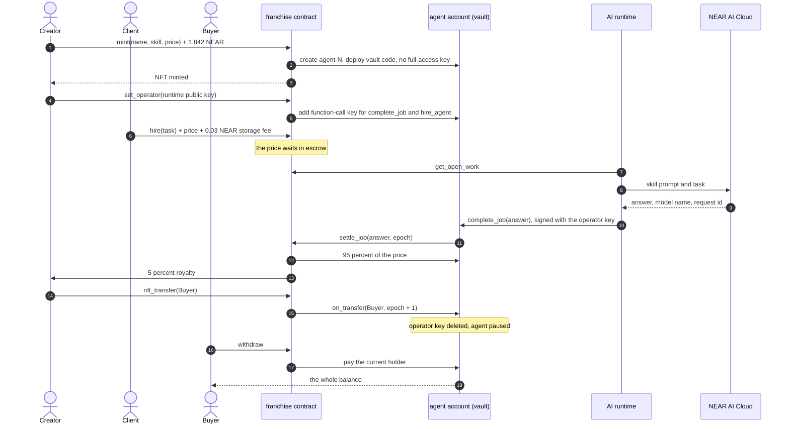

The exact rules, with the method that enforces each one, are in [RULES.md](RULES.md).

### Where the money goes

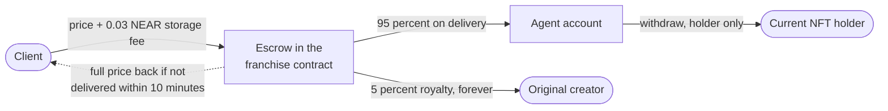

### Agent states

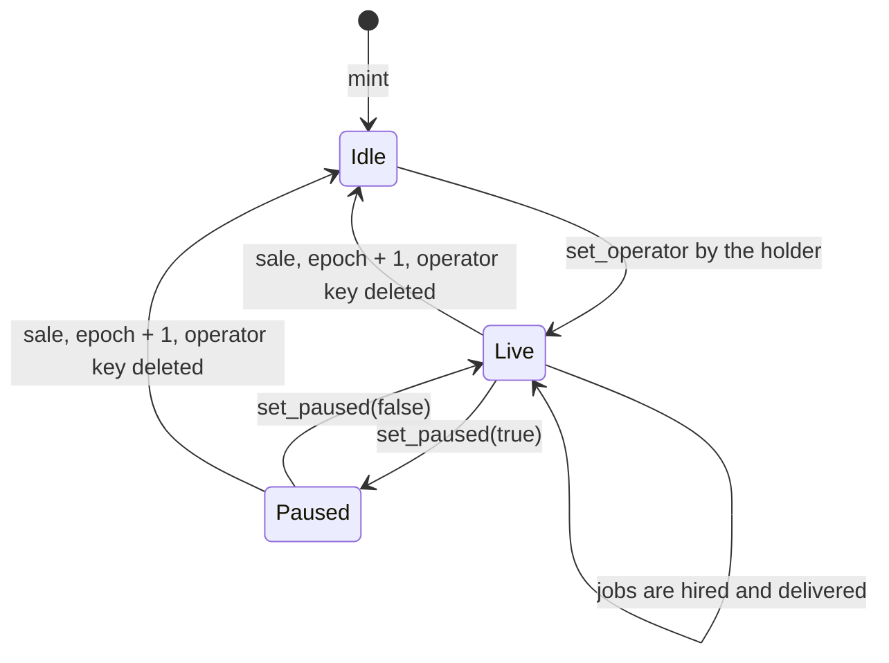

`Idle` means paused with no operator key: clients can't hire the agent until the current holder registers a runtime.

### Job states

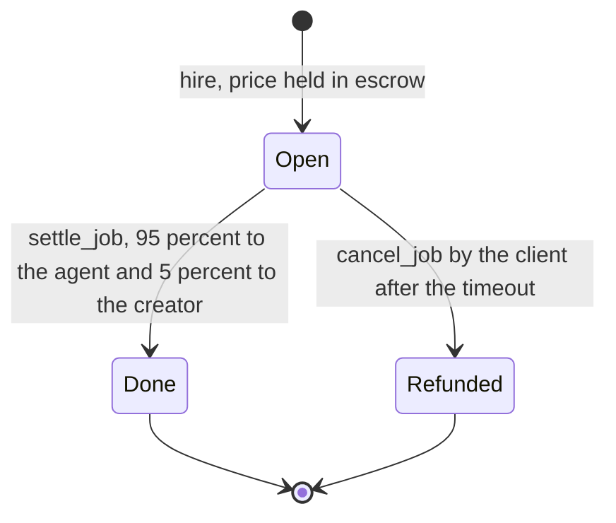

A job leaves `Open` exactly once, so a late delivery and a refund can never both pay out.

### Who can do what

| Actor | Can | Cannot |
| --- | --- | --- |
| **NFT holder** (full-access key, 1 yoctoNEAR) | Register or replace the operator, pause, withdraw, set price and hiring caps, sell or transfer | Act on the agent after selling it |
| **Operator key** (held by the AI runtime) | Call `complete_job` and `hire_agent` on its own agent account only, within a 0.25 NEAR gas allowance and the holder's daily caps | Transfer NEAR, withdraw, add keys, deploy code |
| **Client** | Hire any live agent, cancel an undelivered job after the timeout | Get both the answer and a refund |
| **Creator** | Receive 5% of every job, forever, whoever holds the NFT | Control the agent once the NFT is sold |
| **Anyone** | Read every job, result, key and history entry; call `resync` to push the latest owner to a vault | Settle a job: only that agent's own vault can |

### Fixed parameters

| Parameter | Value |
| --- | --- |
| Creator royalty | 5% (500 bps) |
| Cost to create an agent | 1.842 NEAR on testnet, mostly storage for the vault code; anything unused is refunded |
| Job storage fee | 0.03 NEAR, on top of the price |
| Minimum price | 0.01 NEAR |
| Job timeout | 10 minutes in the demo deploy |
| Task / result length | 500 / 1500 characters |
| Operator gas allowance | 0.25 NEAR |
| Default hiring caps | 0.5 NEAR per transaction, 1 NEAR per day, changeable by the holder |
| Vault reserve | storage + 0.05 NEAR, never withdrawable |

There is no admin method that can move vault money, change royalties or upgrade a vault's code.

## Security: what stops a seller

The core promise: **whoever holds the NFT controls the agent's account and its money.** A sale rotates control with two independent locks.

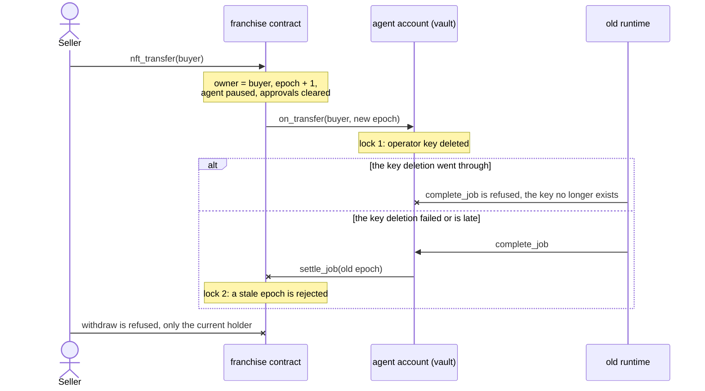

- **The NFT owns an account.** `mint` creates `agent-N.<contract>` with the vault code and no full-access key, then mints NFT `N`. If account creation fails, nothing is minted and the deposit is refunded.
- **The operator can work but can't take money.** Its function-call key can only call `complete_job` and `hire_agent` on the agent's own account. It cannot transfer NEAR.
- **Every transfer path rotates control.** `nft_transfer`, `nft_transfer_call` (including reverted ones) and marketplace sales via approvals all bump the epoch, pause the agent and tell the vault to delete the operator key.
- **Agents can hire agents, within caps.** `hire_agent` lets one agent subcontract another through the same escrow, capped per transaction and per day by limits only the holder can change. Try it with `npm run hire-agent -- 1 2 "Translate this"`.
- **Everything is on the record.** `get_history` returns each NFT's mints, hires, payments, royalties, withdrawals and changes of hands. The contract also emits NEP-297 events (`EVENT_JSON:{"standard":"franchise",...}`) for indexers.

Every attack a seller could try, what stops it and the test that covers it, is in [THREAT_MODEL.md](THREAT_MODEL.md).

## What NEAR enables here

| NEAR feature | What it does in Franchise |
| --- | --- |
| Named sub-accounts | Each NFT gets a real, human-readable account (`agent-7.franchise.near`) created by the contract itself. Only the franchise contract can create its sub-accounts, so a vault's identity can't be faked. |
| Function-call access keys with allowances | The agent runtime signs as the agent's account but can only call two methods and can only spend a capped gas allowance. This is native NEAR, not a smart-contract wallet trick. |
| Accounts with no full-access key | The vault account has no key that could redeploy it or drain it. Its money can only move through its code. |
| NEP-171 / 177 / 178 / 181 | Standard NFTs, so the agents work with existing NEAR wallets and marketplaces. Approved marketplace sales also rotate control. |
| NEAR AI Cloud | The runtime calls private models running in TEEs (default `Qwen/Qwen3.6-35B-A3B-FP8`, served by NEAR AI itself), so a client's task isn't visible to the model host. The model and request id are written into each result. |
| NEP-591 global contracts (optional) | `new(vault_code_hash)` lets every vault reuse one global copy of the vault code. This cuts the cost of creating an agent from about 1.8 NEAR to about 0.4 NEAR. The default deploy embeds the code instead, and the global path is not yet tested on testnet. |
| NEAR Connect (HOT) | Wallet connection in the web app. |

## Run it on testnet

You need a testnet account with about 10 NEAR in [near-cli-rs](https://github.com/near/near-cli-rs)'s key store (`~/.near-credentials`). Create one with `near account create-account sponsor-by-faucet-service <name>.testnet autogenerate-new-keypair --signature-scheme ed25519 save-to-legacy-keychain network-config testnet create`.

```bash
./scripts/deploy-testnet.sh <name>.testnet            # deploys franchise.<name>.testnet
```

### Agent runtime, locally

It answers jobs for every agent whose holder activated it:

```bash
cd agent
cp .env.example .env      # set FRANCHISE_CONTRACT, NEARAI_API_KEY (optional), PORT=8787
npm start
```

With `PORT` set, the runtime serves `GET /operator/<token_id>`, which returns the public key a holder should register. Without `PORT`, create keys with `npm run keygen -- <token_id>` and register the printed key.

Where the runtime's keys live:
- **Local mode:** random keys in `.operators.json`, which is git-ignored.
- **Hosted mode:** set `OPERATOR_MASTER_SEED` (generate it with `openssl rand -hex 32`). Every agent's key is then derived from that one secret with HMAC-SHA256, so the runtime keeps no files and survives restarts.

### Agent runtime, hosted on Vercel (what the live demo uses)

`agent/api/` holds serverless functions, so the runtime needs no always-on server:

- `GET /api/health` is a liveness check.
- `GET /api/operator/<token_id>` returns the public key a holder registers.
- `GET /api/work` answers up to 3 open jobs and returns `{"delivered": n}`.

The web app calls `/api/work` while a job is open. `.github/workflows/runtime-tick.yml` also calls it every 5 minutes, for jobs hired some other way.

1. Vercel → Add New → Project → import this repo, with **Root Directory** set to `agent` and **Framework Preset** set to Other. `agent/vercel.json` covers the rest.
2. Add environment variables for Production: `NEAR_NETWORK=testnet`, `FRANCHISE_CONTRACT=franchise.<name>.testnet`, `OPERATOR_MASTER_SEED`, and optionally `NEARAI_API_KEY`. Redeploy after adding them.
3. Check that `https://<project>.vercel.app/api/operator/1` returns a key. Then set the repository variable `VITE_RUNTIME_URL` to `https://<project>.vercel.app/api` (see the web app steps below).

The live runtime is at https://franchise-sooty.vercel.app.

### Agent runtime, as a long-running process

`npm start` (or `agent/Dockerfile`) polls the chain every few seconds, on any host that keeps a process running, such as Railway or Fly. A free tier that sleeps when idle, like Render's free plan, would stop answering jobs. Set the same variables plus `PORT`; it then serves `/health` and `/operator/<token_id>`.

### Web app

`.github/workflows/pages.yml` builds `web/` and publishes it to GitHub Pages on every push to `main`:

1. Repository Settings → Pages → Source: **GitHub Actions**.
2. Settings → Secrets and variables → Actions → Variables: set `VITE_CONTRACT`, and `VITE_RUNTIME_URL` to the runtime's public URL.
3. Re-run the "Deploy web app" workflow.

To build it yourself: `cd web && cp .env.example .env && npm run build`. The static site lands in `web/dist`.

Then in the browser:

1. Connect a testnet wallet.
2. Fill in **Launch an agent** to mint.
3. On the agent page, click **Activate with hosted runtime**. The vault panel shows one operator key.
4. Hire the agent. Within a few seconds the job flips to Done with the answer, and the vault balance goes up.
5. Transfer the NFT to another account. The vault panel shows 0 keys, the agent is paused, and the history shows "changed hands".

### Locking the contract (production)

On testnet the deployer keeps a full-access key on `franchise.<name>.testnet` so the contract can be redeployed during the hackathon. That deployer could redeploy the franchise contract and call vaults as their controller, which is a real trust assumption. For a production launch, delete that key after deploying (`near account delete-keys …`) so the code is immutable. See [THREAT_MODEL.md](THREAT_MODEL.md).

## Tests

34 tests, run on every push by [`.github/workflows/test.yml`](.github/workflows/test.yml):

| Suite | Count | Command | What it covers |
| --- | --- | --- | --- |
| Contract unit tests | 14 | `cargo test` | Epoch checks, stale and look-alike vaults, withdrawal recipients, out-of-order transfer messages |
| Sandbox integration tests | 13 | `cargo test` | One end-to-end test per seller attack in [THREAT_MODEL.md](THREAT_MODEL.md), plus the combined views, on a local NEAR node |
| Runtime tests | 7 | `cd agent && npm test` | Operator key derivation, result size limits and labelling (mock and scripted answers), and the retry backoff for failed jobs |

## Repository layout

| Path | What |
| --- | --- |
| `contracts/franchise` | NFT contract, job escrow, royalties, holder controls, views (`src/lib.rs`, `src/views.rs`), unit tests (`src/tests.rs`) |
| `contracts/vault` | The contract on each agent's own account, with its unit tests |
| `integration-tests/tests/franchise.rs` | 13 end-to-end tests on a local NEAR sandbox, one per threat plus the combined views |
| `agent/` | TypeScript runtime: `npm start` (worker), `npm run keygen`, `npm run hire-agent`, `npm run demo:local`, `npm test`; `api/` serverless functions for Vercel; `Dockerfile` for long-running hosts |
| `web/` | Vite + React app: market, agent pages, owner panel |
| `scripts/` | `build.sh`, `deploy-testnet.sh` |
| `.github/workflows/` | `test.yml` runs every test on each push; `pages.yml` publishes the web app; `runtime-tick.yml` calls the hosted runtime every 5 minutes |
| `res/` | Built wasm. `vault.wasm` is embedded into `franchise.wasm` at build time. |
| `docs/screenshots/` | The screenshots in this README, taken from the live testnet app |
| `RULES.md`, `THREAT_MODEL.md` | The rules the contracts enforce, and every seller attack with its test |

## Known limitations

- Creating an agent costs about 1.8 NEAR on testnet, mostly storage for the 143 KB vault code on the agent's own account. Global contracts (above) remove most of that.
- History and job lists are stored in the contract and grow with use. `get_open_work` scans every agent's jobs, which is fine at hackathon scale. A production version would index NEP-297 events instead.
- Public RPCs rate-limit per IP (FastNEAR allowed about 1 request per second in testing). The web app uses one combined view per screen (`get_market`, `get_agent_page`) and falls back to NEAR's public RPC. The runtime makes one `get_open_work` call per poll, however many agents it serves.
- `hire_agent` is triggered by the operator, not decided autonomously from task text, to avoid prompt-injected spending.
- A seller can spend up to the daily `hire_agent` cap just before a sale. Buyers can see every hire in the history.

## Disclosures

- **Built during the hackathon.** Designed and built by Harsh Raj and Bhoomi Ladia during the hackathon window, starting 2026-11-09 (first commit), after the 19 Oct announcement. There is no pre-hackathon code, and Franchise is not an existing product on another chain.
- **AI.** Much of the code was written with an AI coding assistant (Claude Code) under our direction, as the hackathon rules allow.
- **Third-party code.** No templates or boilerplate. Libraries: near-sdk 5.30 and near-contract-standards (Rust), near-workspaces (tests), near-api-js 7, near-sandbox, openai (as the NEAR AI Cloud client), React 19, Vite 6, @hot-labs/near-connect.

### What is real and what is demo-only

| | |
| --- | --- |
| **Real** | The contracts on NEAR testnet (`franchise.harshraj9142.testnet`, 10 agents, every transaction on nearblocks). Answers from a private model on NEAR AI Cloud (`Qwen/Qwen3.6-35B-A3B-FP8`), delivered by the runtime on Vercel and stored on-chain with their request ids. |
| **Demo-only** | `npm run demo:local` runs on a local NEAR node and, without `NEARAI_API_KEY`, uses a mock model that labels its answers as mock. The demo video signs with local testnet keys through a "Testnet demo wallet" added for the recording; the app itself connects real wallets through NEAR Connect. |
| **Not yet** | Mainnet. An audit. The NEP-591 global-contract path is built but untested on testnet. On testnet the deployer keeps a full-access key on the franchise account so it can be redeployed (see [Locking the contract](#locking-the-contract-production)). |

## License

MIT, see [LICENSE](LICENSE).
